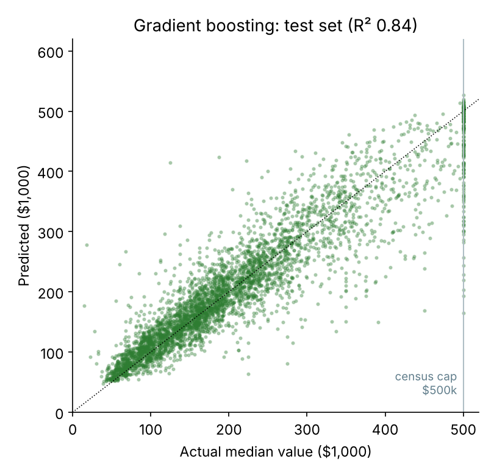
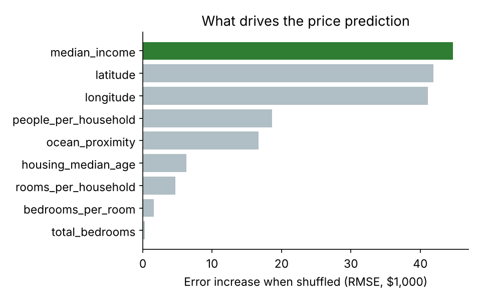
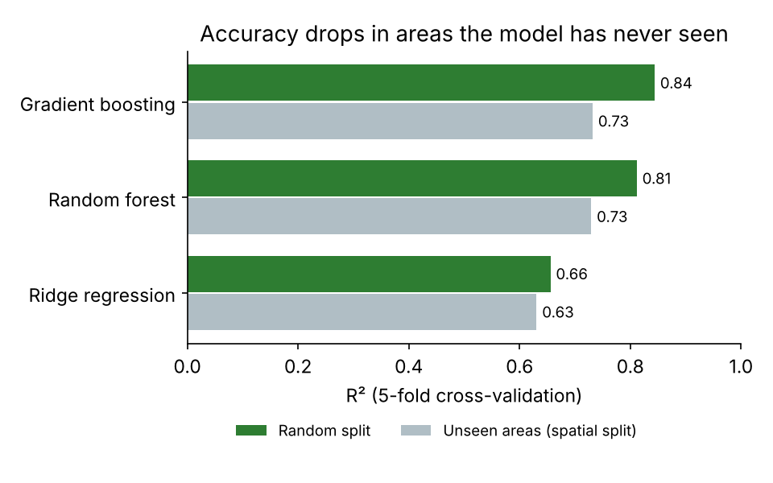
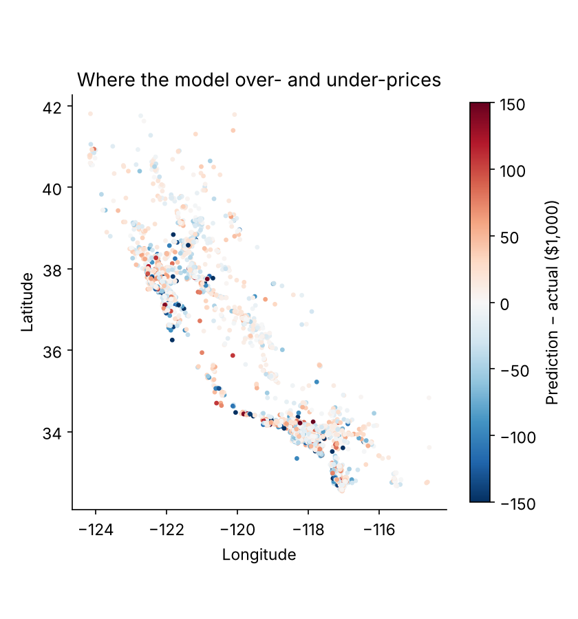

# California House Price Prediction

Predicts the median house value of a California district from census data. The best model, gradient boosting, explains **84% of the variation in prices (R² 0.84)**, with a typical error of **$29,800**. It places **72% of districts within ±20%** of their true value.



## Results

The data covers 20,640 census districts (block groups) from the 1990 US Census, the classic California Housing dataset. Each district has its location, median income, housing age, room and population counts, and distance to the ocean. 80% of districts are used for training and 20% are held out for testing.

| Model | Test RMSE | Test MAE | Test R² | R² in unseen areas* |
|---|---|---|---|---|
| Baseline (always predict the median) | $117,312 | $87,404 | −0.05 | −0.06 |
| Ridge regression | $69,135 | $49,652 | 0.64 | 0.63 |
| Random forest | $49,321 | $31,673 | 0.81 | 0.73 |
| **Gradient boosting** | **$45,421** | **$29,844** | **0.84** | **0.73** |

\* *Unseen areas:* cross-validation where the map is cut into 0.5° squares and whole squares are held out at once. Neighbouring districts have similar prices, so a random split is partly a test of "remembering the neighbours". The spatial split shows how the model does in a part of the state it has never seen.

| | |
|---|---|
|  |  |

**What drives prices.** Median income is the strongest single predictor. Shuffling it raises the error by about $45,000. Latitude and longitude come next, almost as strong: in California, *where* matters as much as *who*. Household crowding (people per household) and ocean proximity follow.

**Where it struggles.** The error map shows that the largest misses cluster in the San Francisco Bay Area and along the Los Angeles coast, where prices vary sharply from street to street.



**A data quirk handled openly.** House values in the original census release were capped at $500,001; 992 districts sit at the cap. Their true values are higher, so no model can predict them correctly. On the uncapped test districts alone, gradient boosting reaches R² 0.82 with RMSE $41,616.

## How it works

1. **Feature engineering:** raw totals mostly measure district size, so ratios are added: rooms per household, bedrooms per room and people per household. Missing bedroom counts (207 districts) are filled with the median.
2. **Models:** a median baseline, ridge regression, a random forest (300 trees) and histogram gradient boosting (scikit-learn).
3. **Model selection:** by 5-fold cross-validation on the training set; the test set is used once, at the end.
4. **Explainability:** permutation importance on the test set and a map of prediction errors.

## Run it

```bash
pip install -r requirements.txt
python train.py           # trains and evaluates all models, writes results/ and models/ (~4 min)
python predict.py --income 8.3 --lat 37.88 --lon -122.23 --age 41 --rooms 880 \
    --bedrooms 129 --population 322 --households 126 --ocean "NEAR BAY"
# Predicted median house value: $436,314 (1990 dollars)
python -m pytest tests
```

`--income` is median household income in tens of thousands of dollars (8.3 = $83,000).

## Project structure

```
├── data/housing.csv      California Housing (1990 census)
├── src/housing.py        loading, feature engineering, spatial groups, models
├── train.py              training, evaluation and figures
├── predict.py            price for a district you describe
├── tests/                unit tests
└── results/              metrics.json and figures
```

## Data and licence

California Housing comes from R. K. Pace and R. Barry, *Sparse Spatial Autoregressions*, Statistics & Probability Letters 33 (1997) 291–297. This version, with the `ocean_proximity` column, is the one distributed with A. Géron's *Hands-On Machine Learning*. Prices are in 1990 US dollars, so this is a learning project and not a valuation tool. The code is released under the MIT licence.
